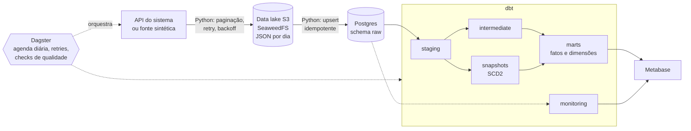
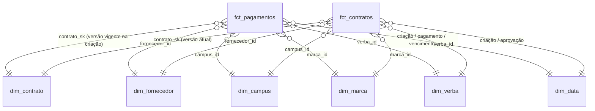

# Data Warehouse de Contratos e Pagamentos (ELT)

Pipeline ELT de ponta a ponta que extrai contratos e pagamentos de fornecedores da API de um
sistema interno, guarda o dado bruto num data lake compatível com S3, carrega num data warehouse
PostgreSQL, modela em estrela com dbt (com histórico SCD2 e modelo incremental), orquestra com
Dagster e entrega dashboards no Metabase. Tudo roda localmente com Docker Compose.

> O projeto foi construído sobre a API real de um sistema da empresa onde trabalho. Para publicá-lo,
> há um **modo sintético** (Faker) que gera dados no mesmo formato da API. Nenhuma credencial,
> endereço ou dado real está no repositório.

---

## O problema de negócio

A área responsável por suprimentos registra contratos com fornecedores e os pagamentos de cada
contrato num sistema transacional. O sistema mostra registros um a um, mas não responde perguntas
como:

| Pergunta | Onde é respondida |
|---|---|
| Quanto foi **contratado**? | `fct_contratos.valor_contratado` |
| Quanto foi efetivamente **pago**? | `fct_pagamentos.valor_pago` |
| Qual o **saldo** a pagar dos contratos em andamento? | `fct_contratos.saldo` |
| Quanto foi **gasto por fornecedor**? | `fct_pagamentos` × `dim_fornecedor` |
| Extra: quanto **vence** em cada mês (previsão de caixa)? | `fct_pagamentos` × `dim_data` (papel: vencimento) |

## Arquitetura



| Camada | Tecnologia | Papel |
|---|---|---|
| Extração e carga | Python (httpx, tenacity, boto3, psycopg) | Paginação por cursor, retry com backoff, rate limit, upsert idempotente |
| Data lake | SeaweedFS (API S3) | Cópia fiel e imutável de cada extração, particionada por `entidade/ano/mes/dia` |
| Data warehouse | PostgreSQL 16 | Schemas `raw`, `staging`, `intermediate`, `snapshots`, `marts`, `audit`, `monitoring` |
| Transformação | dbt-core + dbt-postgres | Staging, modelo dimensional, SCD2, incremental, 100+ testes, documentação |
| Orquestração | Dagster | Assets Python + dbt num só grafo, agenda diária, retries, checks de volume e freshness |
| Visualização | Metabase | Dashboard de negócio e dashboard de saúde do pipeline |
| Infraestrutura | Docker Compose | Lake, DW e BI sobem com um comando |

## Modelo dimensional

A granularidade foi definida antes de modelar. Contratado e pago vivem em granularidades
diferentes, por isso há **duas fatos**: repetir o valor do contrato em cada pagamento
multiplicaria o contratado nas somas.

| Fato | 1 linha = | Tipo |
|---|---|---|
| `fct_pagamentos` | um pagamento | Transacional, **incremental** |
| `fct_contratos` | um contrato (estado atual) | Accumulating snapshot |



- **`dim_contrato` é SCD tipo 2** (dbt snapshot, estratégia `check`): cada mudança de estado,
  valor ou fornecedor gera uma nova versão com `contrato_sk` próprio e período de validade.
- **`dim_data` é role-playing**: o mesmo calendário responde "pago por mês" e "vencendo por mês".
- **Membro desconhecido (`-1`)** em todas as dimensões: chaves nunca nulas, joins nunca perdem linhas.

## Decisões técnicas

| Decisão | Por quê |
|---|---|
| **Lake + raw no DW** | O lake guarda todas as versões (histórico, reprocessamento sem chamar a API); o `raw` guarda o estado atual consultável pelo dbt. Num lakehouse, o raw no DW seria dispensável. |
| **Extração full diária** em vez de incremental | Medido na API real: o full leva ~13s. O incremental com janela perdia mudanças de pagamentos pendentes antigos (cerca de metade dos pendentes ficava fora da janela). O incremental continua disponível (`--incremental`). |
| **Upsert com duas guardas** | Só atualiza se o payload mudou **e** o arquivo não é mais antigo que o carregado. Rodar duas vezes o mesmo período não duplica nem regride dados. |
| **`raw` com `payload jsonb`** | Campo novo na API não quebra a carga; quem tipa é o staging. |
| **Endpoint S3 por variável** | O mesmo código roda no SeaweedFS local e na AWS. |
| **SeaweedFS no lugar do MinIO** | O MinIO deixou de publicar imagens públicas; o SeaweedFS sobe num contêiner com API S3 completa e o código cliente não mudou. |
| **Renomear pelo significado no staging** | Validado com dados (99,8%): o `amount_paid` do contrato na API é o valor *lançado* em pagamentos (inclui pendentes), não o pago. Virou `amount_committed`. |
| **Snapshot só com atributos** | Valores que mudam a cada pagamento ficam fora do `check_cols`; senão, cada pagamento criaria uma versão nova do contrato. |
| **Incremental `delete+insert` + `post_hook`** | Processa só o que mudou (`_extracted_at` só avança quando o payload muda) e remove linhas que passaram a ser inválidas. |
| **Chaves de data no fuso de Brasília** | O dia que importa para o negócio. |
| **Usuário somente leitura no Metabase** | Lê só `marts` e `monitoring`; o `raw` tem dados pessoais. Grants aplicados pelo dbt a cada execução. |
| **Dagster em vez de Airflow** | Integração nativa com dbt (cada modelo vira asset) e cabe na máquina; o Airflow não roda nativamente no Windows e pede ≥ 4 GB só para ele. `extract/` e `dbt_project/` não dependem do orquestrador. |

## Qualidade de dados e observabilidade

- **100+ testes no dbt**: `unique`, `not_null`, `relationships` (cada chave de fato → dimensão),
  `accepted_values`, testes singulares de reconciliação (contrato × pagamentos, total pago nas
  duas fatos) e validação do SCD2 (uma versão atual por contrato, sem sobreposição).
- **Severidade `warn` para problemas conhecidos da origem**, que viram relatório para a área de
  negócio corrigir, sem parar o pipeline. Exemplos encontrados nos dados reais:
  - pagamentos sem nenhum dado de contrato → mantidos com membro desconhecido;
  - `amount_paid` digitado até 1000x o valor do pagamento → marcados e excluídos das métricas
    (sem isso o "valor pago" ficava inflado em ~7%);
  - data sentinela `2000-01-01` usada pela API para "sem data" → convertida em `NULL`.
- **Checks de volume bloqueantes** no Dagster: queda > 10% avisa; queda > 50% ou zero **bloqueia o dbt**.
- **Freshness**: `dbt source freshness` e `FreshnessPolicy` nas fatos (aviso 26h, falha 50h).
- **Logs de execução** em `audit.extraction_runs` (extração) e `audit.dbt_results` (cada
  modelo/teste, via hooks do dbt), expostos no schema `monitoring` para o painel de saúde.

## Estrutura do repositório

```
├── docker-compose.yml          # SeaweedFS (lake), Postgres (DW), Metabase
├── .env.example                # copie para .env
├── infra/                      # scripts de init do Postgres e do SeaweedFS
├── extract/                    # extração e carga (API/Faker -> lake -> raw)
├── orchestration/              # Dagster: assets, checks, job, schedule
├── dbt_project/
│   ├── models/{staging,intermediate,marts,monitoring}/
│   ├── snapshots/              # SCD2 de contratos
│   ├── tests/                  # testes singulares
│   └── macros/                 # schema por camada, log de execução
├── tests/                      # testes unitários Python (pytest)
└── docs/                       # notas de cada etapa e decisões
```

## Como rodar

**Pré-requisitos:** Docker Desktop e Python 3.12.

```bash
# 1. Configuração (o .env.example já vem com USE_SYNTHETIC_DATA=true)
cp .env.example .env            # ajuste as senhas "change_me"

# 2. Infraestrutura: lake, DW e Metabase
docker compose up -d
docker compose ps               # seaweedfs, postgres e metabase "healthy"

# 3. Ambiente Python
python -m venv .venv
source .venv/bin/activate       # Windows: .\.venv\Scripts\Activate.ps1
pip install -r requirements.txt

# 4. Orquestrador (interface em http://localhost:3001)
export DAGSTER_HOME=$PWD/dagster_home   # Windows: $env:DAGSTER_HOME = "$PWD\dagster_home"
mkdir -p dagster_home
dagster dev -p 3001
```

Na interface do Dagster: **Jobs → `atualiza_dw` → Materialize all**. O job extrai os dados
(sintéticos), grava no lake, carrega no `raw` e roda `dbt build` com todos os testes.

| Serviço | Endereço |
|---|---|
| Dagster | http://localhost:3001 |
| Metabase | http://localhost:3000 (conectar com host `postgres`, usuário `metabase_reader`, schemas `marts` e `monitoring`) |
| Navegador do lake | http://localhost:8888 |
| Documentação do dbt | `cd dbt_project && dbt docs generate && dbt docs serve --port 8081` |

Comandos úteis sem o Dagster:

```bash
python -m extract.main --entity payments          # extração full (padrão)
python -m extract.main --entity payments --incremental
python -m pytest -q                               # testes unitários
cd dbt_project && dotenv -f ../.env run -- dbt build --profiles-dir .
```

## Prints

| | |
|---|---|
| Grafo de assets no Dagster |  |
| Linhagem no dbt docs |  |
| Dashboard de negócio |  |
| Saúde do pipeline |  |

## Limitações e próximos passos

- O schedule do Dagster só dispara com `dagster dev` aberto; o próximo passo é empacotar o
  Dagster num contêiner do Compose.
- O histórico SCD2 começa no primeiro snapshot. Como o lake guarda uma fotografia completa por dia,
  o histórico pode ser reconstruído reprocessando os arquivos (partições por data no Dagster).
- Versão alternativa do orquestrador em Airflow (só `orchestration/` mudaria).
- Dimensões conformadas (`dim_data`, `dim_campus`, `dim_marca`) prontas para novos marts de outras áreas.

## Documentação das etapas

Cada etapa tem um registro com conceitos, comandos, erros encontrados e como foram resolvidos:
[infraestrutura](docs/01-infraestrutura.md) ·
[extração](docs/02-extracao.md) ·
[staging](docs/03-staging-dbt.md) ·
[contratos](docs/04-contratos.md) ·
[modelo dimensional](docs/05-modelo-dimensional.md) ·
[orquestração](docs/06-orquestracao.md) ·
[logs e qualidade](docs/07-logs-e-qualidade.md) ·
[plano e diário de decisões](PLANO.md)
