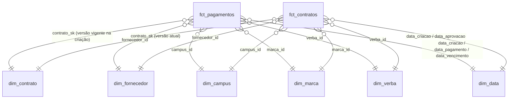

# Etapa 5 – Modelo dimensional

## Para quê
Organizar os dados do jeito que o negócio pergunta: **fatos** guardam os números,
**dimensões** guardam o contexto (quem, onde, quando). Qualquer pergunta vira
`SUM ... GROUP BY` simples no Metabase.

## Processo de negócio e granularidade
Processo: **gestão financeira de contratos** (do contrato ao pagamento).

| Fato | 1 linha = | Tipo | Medidas |
|---|---|---|---|
| `fct_pagamentos` | um pagamento | Transacional, incremental | `valor_pagamento`, `valor_pago`, `valor_pendente`, `valor_cancelado` |
| `fct_contratos` | um contrato (estado atual) | Accumulating snapshot | `valor_contratado`, `valor_pago`, `valor_pendente`, `valor_cancelado`, `valor_comprometido_origem`, `saldo`, `qtd_pagamentos` |

Duas fatos porque o valor contratado mora no contrato e o pago no pagamento: repetir o
contrato em cada pagamento multiplicaria o contratado na soma.

## Diagrama (estrela)


## Linhagem (dbt)
```
raw.payments  -> stg_payments  -> int_pagamentos_por_contrato -> fct_contratos
                               -> fct_pagamentos
raw.contracts -> stg_contracts -> snap_contracts (SCD2) -> dim_contrato -> fatos
                               -> dim_fornecedor / dim_campus / dim_marca / dim_verba
(gerada)                          dim_data
```

## Dimensões
| Dimensão | Tipo | Chave | Membro desconhecido |
|---|---|---|---|
| `dim_contrato` | **SCD2** (snapshot `check`) | `contrato_sk` (= `dbt_scd_id`) | `'-1'` Sem contrato |
| `dim_fornecedor` | SCD1 | `fornecedor_id` | `-1` Não informado |
| `dim_campus`, `dim_marca`, `dim_verba` | SCD1 | id da origem | `-1` Não informado |
| `dim_data` | Calendário 2020–2030 | `date_key` (AAAAMMDD) | `-1` Sem data |

## Respostas às perguntas de negócio
| Pergunta | Definição |
|---|---|
| Valor contratado | `sum(fct_contratos.valor_contratado)` — filtrar estado no dashboard (inclui reprovados/cancelados) |
| Valor pago | `sum(fct_pagamentos.valor_pago)`: `payment_value` dos pagamentos Pago, sem inconsistência |
| Saldo | `sum(fct_contratos.saldo)`: contratado − pago, só contratos Aprovados |
| Gasto por fornecedor | `valor_pago` por `dim_fornecedor` |

Resultado (dados reais): contratos Aprovados somam R$ 146,6 mi contratados, R$ 26,8 mi pagos e
R$ 119,8 mi de saldo; maior fornecedor por valor pago: R$ 9,5 mi.

## Conceitos
- **Granularidade primeiro**: define o que é uma linha; erro aqui = soma errada.
- **Accumulating snapshot**: fato com 1 linha por entidade que acompanha seu ciclo de vida.
- **Membro desconhecido (-1)**: chaves nunca nulas; joins nunca perdem linhas.
- **Role-playing dimension**: a mesma `dim_data` ligada a várias colunas de data da fato.
- **Dimensão degenerada**: `codigo_pagamento`, `estado_pagamento` ficam na fato, sem dimensão própria.
- **SCD1 × SCD2**: tipo 1 sobrescreve (só o atual); tipo 2 cria nova linha com nova SK e período
  de validade. Snapshot diário completo (lake) é a alternativa "moderna"; aqui temos os dois.
- **dbt snapshot `check`**: compara colunas (`check_cols`) quando não há campo de atualização.
  Medidas que mudam a cada pagamento ficam fora para não gerar versões à toa.
- **`dbt_valid_to_current = 9999-12-31`**: versão atual sem NULL, facilita o `BETWEEN`.
- **1ª versão desde 1900-01-01**: o histórico começa no 1º snapshot; fatos antigas encontram versão.
- **Incremental `delete+insert`** por `_extracted_at`; `post_hook` apaga linhas que passaram a
  ser inválidas; **mudou a lógica → `--full-refresh`**.
- **Dia no fuso de Brasília** nas chaves de data.
- **Teste de reconciliação** entre fatos: o total pago tem de bater nas duas.

## Comandos
```powershell
cd dbt_project
$env:DBT_PROFILES_DIR='.'
dotenv -f ..\.env run -- dbt build                                # tudo, na ordem do grafo
dotenv -f ..\.env run -- dbt run --select fct_pagamentos --full-refresh
dotenv -f ..\.env run -- dbt snapshot
dotenv -f ..\.env run -- dbt docs generate
dotenv -f ..\.env run -- dbt docs serve --port 8081               # documentação no navegador
```

## Resultado
`dbt build`: PASS=96 WARN=5 ERROR=0 (101 nós). Segunda execução: `fct_pagamentos` e
`snap_contracts` com `INSERT 0 0` (nada mudou).

| Modelo | Linhas |
|---|---|
| `dim_data` | 4.019 |
| `dim_contrato` | 26.536 |
| `dim_fornecedor` | 3.105 |
| `dim_campus` / `dim_verba` / `dim_marca` | 296 / 63 / 41 |
| `fct_pagamentos` | 27.741 (28.089 − 348 inconsistentes) |
| `fct_contratos` | 26.535 |

## Erros e soluções
| Erro | Causa | Solução |
|---|---|---|
| Função de janela dentro de `count(...) filter` | Postgres não permite | Calcular `lead()` numa CTE antes |
| `relationships` de `data_vencimento_key` falhou (2) | Sentinela `2000-01-01` também no `payment_deadline` | `nullif` no staging; `-1` na fato |
| Correção não alcançava linhas antigas da fato | Incremental só processa linhas novas/alteradas | `--full-refresh` |
